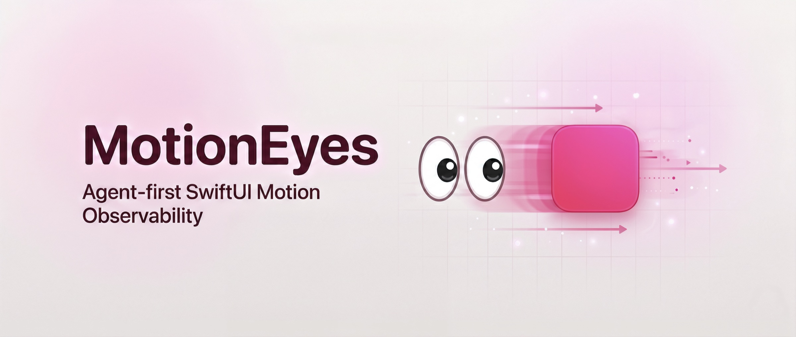
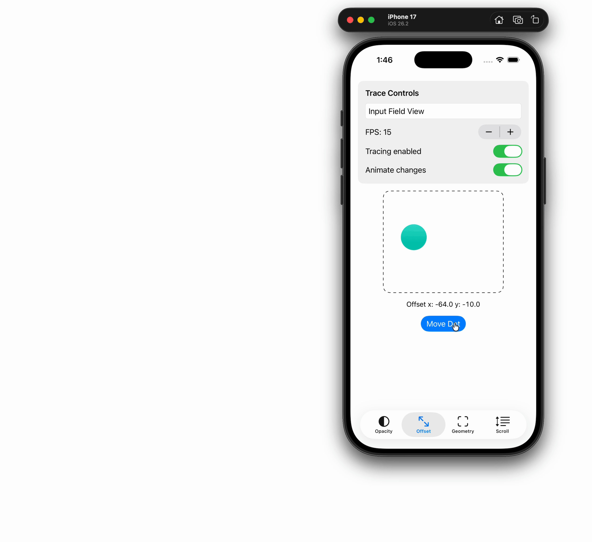
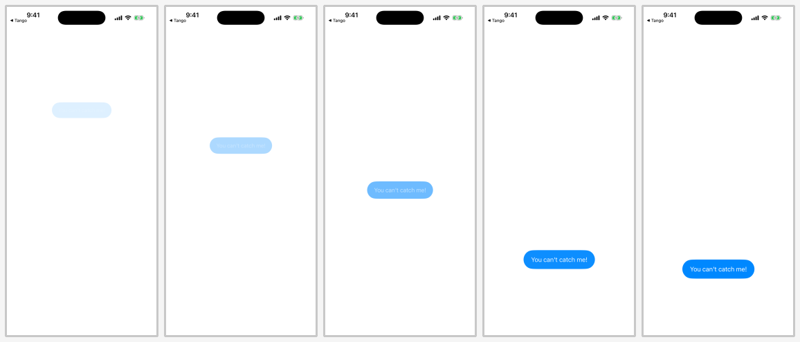
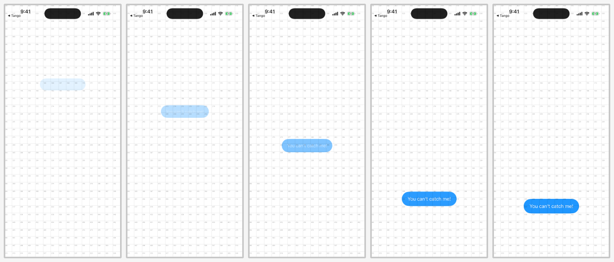
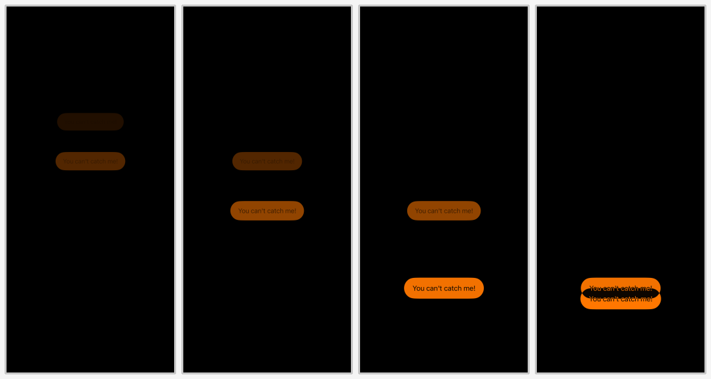

# MotionEyes



MotionEyes is an agent-first SwiftUI motion observability system.

## Overview

MotionEyes combines:
- `package/`: runtime tracing primitives that emit motion data over time (`.motionTrace`, `Trace.value`, `Trace.geometry`, `Trace.scrollGeometry`)
- `skill/motioneyes-animation-debug`: installs or integrates the package, adds focused traces, captures logs, and validates behavior against intent
- `skill/motioneyes-visual-analysis`: analyzes frame sequences with computer vision and produces annotated images plus JSON summaries

The goal is to let agents read real motion, geometry, and scroll values from logs instead of guessing from code.

Skill demo:



## Visual Analysis Outputs

`motioneyes-visual-analysis` can generate keyframe sprites, grid overlays, and pixel diffs for motion analysis. The recommended interpretation flow is:

1. Start with a clean keyframe sprite to understand overall motion progression.
2. Use the matching grid sequence when you need coordinate-aware position checks.
3. Use adjacent-frame diffs for precise pixel-change confirmation.

Example artifacts below were generated from a focused demo sequence:

<p>
  <strong>Keyframe sprite (clean motion progression, 5 selected frames)</strong><br/>
  
</p>

<p>
  <strong>Grid sequence (same 5 frames with coordinate labels)</strong><br/>
  
</p>

<p>
  <strong>Adjacent diff sprite (4 selected-frame deltas)</strong><br/>
  
</p>

### GridGPT Dependency

Grid overlays require the GridGPT submodule at `third_party/GridGPT`.

```bash
git submodule update --init --recursive
test -f third_party/GridGPT/arial.ttf && echo "GridGPT font OK" || echo "GridGPT font missing"
pip3 install -r skill/motioneyes-visual-analysis/requirements.txt
```

Generate analysis artifacts like the examples above:

```bash
python3 skill/motioneyes-visual-analysis/scripts/analyze_sequence.py \
  --video /path/to/capture.mp4 \
  --fps 15 \
  --duration 1.0 \
  --trim \
  --diff-grid \
  --output /path/to/report
```

By default, diff outputs are rendered for keyframe-related pairs only. Add `--all-pairs` when you need `diff/` and `diff_grid/` for every consecutive frame pair.

## How It Works

### End-to-End Flow

1. Define expected behavior in measurable terms.
2. Locate the views and state values that drive the behavior.
3. Ensure MotionEyes is available or integrate it if missing.
4. Add temporary, focused traces to values, geometry, or scroll state.
5. Reproduce the issue and capture MotionEyes logs.
6. Compare observed traces against expected motion relationships and timing.
7. Apply fixes, re-run validation, then remove only the temporary instrumentation added for that run.

### Geometry Modes

`Trace.geometry` separates coordinate target from frame source:
- Layout-relative debugging: `space: .swiftUI(.global), source: .layout`
- Window-relative debugging: `space: .window, source: .layout`
- True on-screen movement: `space: .screen, source: .presentation`

### Tooling and Runtime Requirements

MotionEyes works best alongside Xcode's built-in MCP server for project-aware build and console capture, with RocketSim for simulator interaction, but neither is strictly required.

If MCP is unavailable, agents can still capture and read simulator logs directly:

```bash
xcrun simctl spawn booted log stream \
  --style compact \
  --level debug \
  --predicate 'subsystem == "MotionEyes"'
```

### Limitations

- `.transition` visual behavior is not directly observable when no measurable underlying value is exposed.

## Skills

See `skill/SKILLS.md` for guidance on when to use each skill.

### Repository Layout

- `package/`: MotionEyes Swift package
- `skill/motioneyes-animation-debug/`: MotionEyes agent skill
- `skill/motioneyes-visual-analysis/`: Frame-based visual analysis skill
- `skill/motioneyes-animation-debug/SKILL.md`: Skill workflow definition

### Package Quick Start

From repo root:

```bash
swift build --package-path package
swift test --package-path package
```

## Example Scenarios

- Detect unintended movement in UI that should remain still.
- Confirm expected motion actually happens when a state change should animate.
- Verify movement direction on each axis (for example, up vs down, left vs right).
- Confirm two animations are truly staggered instead of firing together.
- Check that relative positioning between two moving elements stays correct.
- Detect timing drift, including late starts, early stops, or incorrect duration.
- Catch easing or path issues such as overshoot or reversal when smooth one-way motion is expected.
- Diagnose scroll jumps, failed restoration, and content-offset desynchronization.

## Installation

### OpenAI Codex / Agent Skills

The MotionEyes skill lives at `skill/motioneyes-animation-debug/SKILL.md`.

Invoke it with:

```text
$motioneyes-animation-debug
```

### Claude Marketplace

This repo includes `.claude-plugin/plugin.json` and `.claude-plugin/marketplace.json` for Claude Code marketplace distribution.

Personal usage:

1. Add the marketplace.

```text
/plugin marketplace add edwardsanchez/MotionEyes
```

2. Install the skill.

```text
/plugin install motioneyes@motioneyes
```

Project configuration:

```json
{
  "enabledPlugins": {
    "motioneyes@motioneyes": true
  },
  "extraKnownMarketplaces": {
    "motioneyes": {
      "source": {
        "source": "github",
        "repo": "edwardsanchez/MotionEyes"
      }
    }
  }
}
```

## Contributing

Contributions are welcome. Please read `CONTRIBUTING.md` for the workflow, quality standards, and scope guidance.
